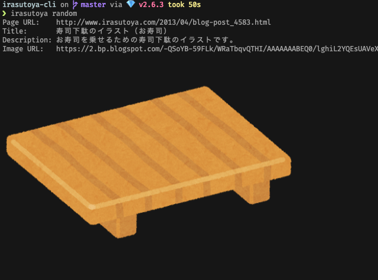

# Irasutoya::Cli

A command-line tool for Ruby developers and terminal users who want to search, preview, and
download free illustrations from [いらすとや](https://www.irasutoya.com/) without leaving the
terminal.

[](https://github.com/irasutoya-tools/irasutoya-cli/actions/workflows/test.yml)
[](https://badge.fury.io/rb/irasutoya-cli)
[](https://codeclimate.com/github/irasutoya-tools/irasutoya-cli)
[](https://codecov.io/gh/irasutoya-tools/irasutoya-cli)
[](https://libraries.io/github/irasutoya-tools/irasutoya-cli)




## Features

- `random` and `search {query}` print an illustration page's URL, title, description, and image
  URLs, and render an inline preview of each image in supporting terminals (iTerm2, Sixel, or an
  ANSI fallback).
- `--jsonl` prints one JSON object per illustration page instead of text, for scripting.
- `download` saves every image from an illustration page, or a list of pages, to a local directory
  (checkout only; see below).

## Installation

Ruby 3.3 or newer is required.

```sh
$ gem install irasutoya-cli
```

## Quick Start

After installing the gem, run a search with a single query argument:

```sh
$ irasutoya search '猫'
```

Run `irasutoya random` to browse a randomly selected illustration or
`irasutoya help` to list the commands available in your installed version.

## Download images from a checkout

The `download` command requires a checkout when using the 1.0.1 release.
Install the Ruby version in [.ruby-version](https://github.com/irasutoya-tools/irasutoya-cli/blob/master/.ruby-version)
and the Bundler version under `BUNDLED WITH` in [Gemfile.lock](https://github.com/irasutoya-tools/irasutoya-cli/blob/master/Gemfile.lock), then run:

```sh
$ git clone https://github.com/irasutoya-tools/irasutoya-cli.git
$ cd irasutoya-cli
$ bundle install
```

Copy the `Page URL` from a search or random result and substitute it for
`PAGE_URL`:

```sh
$ bundle exec exe/irasutoya download 'PAGE_URL' --output ./images
```

Choose an `--output` directory on a filesystem that supports hard links. The command uses hard links to save images, so a FAT32 destination will fail even if it is writable.

The command creates the destination directory if needed, saves images on the page in order, and prints each saved path. If a filename is already taken, the command adds a numeric suffix before the extension. Downloads work in terminals without inline preview support.

The command recognizes PNG, JPEG, GIF, and WebP images by their file signature and saves each with the extension matching its detected format (for example `.jpg` for JPEG), correcting the URL's extension when it disagrees. If an image on the page is in another format, the command reports an error and stops downloading from that page; images already saved earlier in the page are kept.

Each image download is limited to 10 MiB (10,485,760 bytes). If an image exceeds the limit, the command stops and discards that download. Images already saved are kept.

See [Getting started](https://github.com/irasutoya-tools/irasutoya-cli/blob/master/docs/getting-started.md)
for a longer first walkthrough of the gem and a checkout.
See the [CLI reference](https://github.com/irasutoya-tools/irasutoya-cli/blob/master/docs/usage.md)
for checkout command arguments, output, and preview behavior.
See [FAQ and troubleshooting](https://github.com/irasutoya-tools/irasutoya-cli/blob/master/docs/troubleshooting.md)
for help with missing commands, previews, and download destinations.

## Contributing

Bug reports and pull requests are welcome on GitHub at https://github.com/irasutoya-tools/irasutoya-cli. This project is intended to be a safe, welcoming space for collaboration, and contributors are expected to adhere to the [Contributor Covenant](http://contributor-covenant.org) code of conduct.

## License

The gem is available as open source under the terms of the [MIT License](https://opensource.org/licenses/MIT).

## Code of Conduct

Everyone interacting in the Irasutoya::Cli project’s codebases, issue trackers, chat rooms and mailing lists is expected to follow the [code of conduct](https://github.com/irasutoya-tools/irasutoya-cli/blob/master/CODE_OF_CONDUCT.md).

## Author

[@unhappychoice](https://unhappychoice.com)
